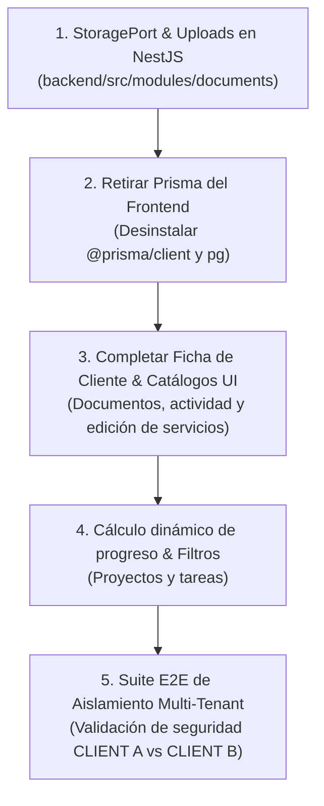

# Estado del Panel de Cliente, Pendientes y Siguientes Pasos

> **Actualización — 19 de octubre de 2026:** se completaron los E2E de conversión/tareas/hitos y ciclo de documentos, la gestión de demos y el ensayo de restauración de base+archivos. Hay configuración y procedimiento de despliegue preparados, sin publicación en producción. La Iteración 5 queda cerrada técnicamente en local, con lint sin errores y aceptación documentada. La siguiente fase es configurar y verificar el destino real. Consultar `CIERRE-ITERACION-5-2026-10-19.md` en `panel-cliente/docs` para evidencia y límites; las brechas del día 16 conservadas abajo son históricas.

> **Actualización comprobada — 17 de octubre de 2026:** esta auditoría del día 16 es histórica y varias brechas ya están resueltas en código (StoragePort, archivos en NestJS, retiro de dependencias Prisma del frontend y ficha integrada de cliente). Se añadió y ejecutó la suite PostgreSQL temporal con dos clientes: 9 migraciones y 7 pruebas de aislamiento aprobadas. También pasan 23 pruebas unitarias backend, build backend y 5 pruebas del portal. La validación de producción sigue abierta: faltan cobertura E2E de conversión/tareas, revisión visual y backup/restauración. Consulta `backend/TESTS.md` y `frontend/docs/PLAN-ITERACIONES-ACTUALIZADO.md` para el comando y límites actuales.

> **Fecha de auditoría:** 16 de octubre de 2026  
> **Ámbito:** `panel-cliente` (Frontend Next.js 16 + Backend NestJS + Portal de Clientes + ERP Interno)

---

## 1. Resumen Ejecutivo y Estado Actual

El sistema se compone de dos aplicaciones dentro del monorepo/workspace de `panel-cliente`:
- **Backend (`panel-cliente/backend`):** API modular en **NestJS** sobre **Prisma / PostgreSQL**. Contiene los módulos de `administration`, `catalogs`, `clients`, `dashboard`, `documents`, `leads`, `payments` y `projects`. Compila sin errores y pasa la totalidad de sus pruebas unitarias (15/15) y de integración e2e.
- **Frontend (`panel-cliente/frontend`):** Aplicación en **Next.js 16** con **Tailwind CSS v4**. Utiliza Better Auth de forma transitoria para emisión de sesiones y delega la lógica de negocio y datos a la API de NestJS vía `backendFetch`. Compila limpiamente en producción y pasa sus pruebas de fiabilidad del portal (`pnpm test:portal`).

### Matriz de Estado por Módulo

| Módulo / Vista | Funcionalidad Implementada | Estado Actual |
| :--- | :--- | :--- |
| **Portal de Cliente: Dashboard** (`/client/dashboard`) | Resumen de proyecto activo, barra de avance, siguiente hito, próximo vencimiento de pago y documentos compartidos. | **Completo y funcional** |
| **Portal de Cliente: Proyectos** (`/client/projects` y `/[projectId]`) | Detalle con línea de tiempo visual, fases/sprints, hitos completados y pendientes, entregables, documentos y cuotas vinculadas. | **Completo y funcional** |
| **Portal de Cliente: Pagos** (`/client/payments`) | Calendario de pagos, guía detallada de canales bancarios (BCP, Interbank, BBVA, Yape/Plin), modal para reporte de comprobante con estado `UNDER_REVIEW`. | **Completo y funcional** |
| **Portal de Cliente: Documentos** (`/client/documents`) | Listado, filtros, visor interactivo (PDF, imágenes, DOCX vía previsualizador integrado) y descarga segura con validación de cliente. | **Completo y funcional** |
| **Portal de Cliente: Perfil y Ayuda** (`/client/profile`, `/client/help`) | Datos de contacto de la cuenta y canales de soporte directo. | **Completo y funcional** |
| **Gestión Interna: Proyectos** (`/internal/projects`) | CRUD de proyectos, resumen operativo, vistas de tareas (Gantt, Kanban, Sprints), hitos, alcance, entregables y documentación. | **Funcional** (filtros y cálculo de avance requieren refinamiento) |
| **Gestión Interna: Pagos** (`/internal/payments`) | Listado, creación de cuotas, actualización de estados y modal administrativo para revisión/verificación de comprobantes reportados. | **Completo y funcional** |
| **Gestión Interna: Leads y CRM** (`/internal/leads`) | Registro de prospectos, notas de seguimiento y conversión transaccional a cliente + proyecto. | **Completo y funcional** |
| **Gestión Interna: Clientes** (`/internal/clients`) | Listado general, creación y vista de detalle con proyectos y pagos asociados. | **Parcial** (falta ficha integrada de documentos, leads y actividad) |
| **Gestión Interna: Catálogos** (`/internal/services`, `/internal/products`) | Endpoints y acciones para crear/editar/eliminar servicios, sectores y productos propios. | **Parcial en UI** (falta formulario de edición en la vista de servicios) |
| **Gestión Interna: Administración** (`/internal/workers`, `/internal/settings`) | Gestión de colaboradores (roles, activación/desactivación, prevención de auto-bloqueo) y configuración general de la empresa. | **Completo y funcional** |
| **Dashboard Operativo** (`/internal/dashboard`) | Bandejas para tareas atrasadas, bloqueadas, asignadas, próximas entregas y proyectos sin responsable. | **Completo y funcional** |

---

## 2. Lo que Queda Planificado y Aún No se ha Cubierto

De acuerdo con [`PLAN-ITERACIONES-ACTUALIZADO.md`](file:///Users/leoaguinaga/apps/foxcode/panel-cliente/frontend/docs/PLAN-ITERACIONES-ACTUALIZADO.md), [`ROADMAP-ERP.md`](file:///Users/leoaguinaga/apps/foxcode/panel-cliente/frontend/docs/ROADMAP-ERP.md) y [`PRD.md`](file:///Users/leoaguinaga/apps/foxcode/panel-cliente/frontend/docs/PRD.md), las brechas pendientes son:

### 2.1. Migración de Documentos y Evidencias a NestJS (Iteración 2)
* **Situación actual:** La subida y persistencia de archivos se realiza todavía en rutas API de Next.js (`frontend/app/api/uploads/route.ts` y `frontend/app/api/payments/[id]/report/route.ts`), escribiendo en el disco local del frontend e invocando directamente a Prisma.
* **Trabajo pendiente:**
  1. Definir un `StoragePort` con su implementación inicial `LocalStorageAdapter` en `backend/src/modules/documents`.
  2. Implementar los endpoints `POST /documents` (multipart) y `GET /documents/:id/download` con streaming y validación de permisos en NestJS.
  3. Modificar el frontend para que delegue la carga de archivos (documentos y vouchers de pago) a los endpoints de NestJS.

### 2.2. Retiro Definitivo de Prisma del Frontend (Iteración 4)
* **Situación actual:** Aún existen 5 archivos en el frontend con dependencias directas a Prisma:
  - `frontend/src/lib/server/activity.ts`
  - `frontend/app/api/payments/[id]/report/route.ts`
  - `frontend/app/api/uploads/[documentId]/docx-preview/route.ts`
  - `frontend/app/api/uploads/[documentId]/route.ts`
  - `frontend/app/api/uploads/route.ts`
  - Imports de enums (`Role`, `UserStatus`) en `frontend/src/modules/users/server/actions.ts`.
* **Trabajo pendiente:**
  1. Redirigir el registro de actividad y las consultas de documentos al backend NestJS.
  2. Eliminar `src/lib/prisma.ts` y remover `@prisma/client`, `prisma` y `pg` de `frontend/package.json`.
  3. Publicar la especificación OpenAPI (Swagger) en NestJS (`/docs`) y generar los tipos compartidos para el cliente HTTP.

### 2.3. Completitud de la Superficie Interna (Iteración 1 e Iteración 3)
* **Ficha de Cliente Integrada (`/internal/clients/[clientId]`):**
  - Actualmente solo lista proyectos y pagos.
  - Pendiente integrar: documentos vinculados al cliente, leads históricos relacionados y línea de tiempo de `ActivityLog`.
  - En el listado general de clientes: agregar filtros por estado/responsable y detección preventiva de duplicados (por RUC o correo).
* **Filtros Avanzados y Avance en Proyectos (`/internal/projects`):**
  - Agregar filtros por responsable, producto, servicio y fecha límite.
  - El porcentaje de progreso (`project.progress`) se maneja actualmente como un número estático; debe calcularse de manera automática a partir de las tareas e hitos completados.
* **Interfaz de Edición de Catálogos:**
  - En `/internal/services`, las Server Actions para actualizar servicios y sectores ya están escritas (`updateServiceAction`, `updateSectorAction`), pero falta incluir los modales/formularios de edición en la interfaz de usuario.
* **Módulo de Demos y Clientes Beta (PRD 8.1.7):**
  - El PRD especifica un módulo de seguimiento comercial de productos propios (comenzando por FoxRooms en `/internal/products`), para registrar demostraciones emitidas, hoteles contactados, estado comercial (`DEMO_REQUESTED`, `DEMO_GIVEN`, `BETA_USER`, `PAYING_CUSTOMER`, `LOST`) y notas de seguimiento. Actualmente solo existe un contador numérico plano.

### 2.4. Validación de Producción y Pruebas Multi-Tenant (Iteración 5)
* **Prueba E2E Multi-Cliente:**
  - Crear una suite de pruebas E2E contra una base de datos PostgreSQL real efímera que pruebe dos clientes distintos (`CLIENT A` y `CLIENT B`) para validar que jamás haya fugas de información (descargas cruzadas de documentos, visualización de proyectos o pagos ajenos).

---

## 3. Plan de Cierre Inmediato (Paso a Paso)

Para dejar el sistema al 100% según las especificaciones técnicas planificadas, el orden recomendado de ejecución es:

1. **Migrar Uploads/Downloads a NestJS:** Añadir manejo multipart (`multer`/`StoragePort`) en `backend/src/modules/documents` y apuntar las subidas de documentos y reportes de pago a la API.
2. **Retiro total de Prisma en el Frontend:** Reemplazar las 5 referencias restantes y eliminar las dependencias del `package.json` de Next.js.
3. **Completar Ficha de Cliente y Catálogos en UI:** Integrar documentos, actividad y leads en `/internal/clients/[clientId]`, y habilitar edición de servicios en `/internal/services`.
4. **Automatización de Progreso en Proyectos:** Calcular el porcentaje de avance de cada proyecto en base al ratio de tareas e hitos cerrados.
5. **Ejecutar Pruebas E2E de Aislamiento:** Validar el comportamiento seguro entre roles y clientes con datos reales.

---

## 4. Siguientes Pasos (Roadmap Estratégico Post-Cierre)

Una vez completadas las iteraciones base y estabilizada la arquitectura desacoplada, la evolución del producto continuará con las siguientes fases:

### Fase 1: Despliegue en Producción y Almacenamiento en la Nube
- **Cloud Storage (S3 / Cloudflare R2):** Reemplazar el `LocalStorageAdapter` por un adaptador de almacenamiento en la nube S3-compatible, asegurando que los documentos y vouchers no dependan del disco efímero de los contenedores/servidores.
- **Infraestructura de Despliegue:**
  - Frontend Next.js desplegado en Vercel o Node.js VPS.
  - Backend NestJS desplegado en VPS / Railway / Render con variables de entorno seguras y política de CORS restringida al dominio del panel.
  - Base de datos PostgreSQL en servicio gestionado (Neon o RDS) con backups automatizados.
- **Endurecimiento de Seguridad:** Configurar cookies con banderas `Secure`, `HttpOnly`, `SameSite=Strict` o `Lax`, y habilitar rate-limiting en los endpoints de autenticación y carga.

### Fase 2: Captación Automática desde la Landing Page
- **Integración Landing → API Leads:** Conectar los formularios de contacto, cotización y solicitud de reunión de la web principal (`landing/`) al endpoint `POST /leads` del backend.
- **Asignación Automática:** Asignar automáticamente los nuevos prospectos a los colaboradores comerciales según el tipo de servicio o producto consultado.

### Fase 3: Notificaciones y Canales Automatizados (Email / WhatsApp)
- **Confirmaciones al Cliente:**
  - Envío automático de confirmación por correo cuando el cliente reporta un pago.
  - Notificación inmediata cuando la administración aprueba o rechaza el pago.
  - Notificaciones de nuevos entregables disponibles para revisión o descarga.
- **Alertas Internas para el Equipo:**
  - Notificación en tiempo real cuando ingresa un lead o cuando un pago queda en estado `UNDER_REVIEW`.
  - Alertas preventivas sobre tareas o hitos próximos a vencer.

### Fase 4: Pasarela de Pagos en Línea y Facturación Electrónica
- **Cobro en Línea Directo:** Integrar pasarelas de pago (como Culqi, Niubiz, Stripe o MercadoPago) para permitir el pago de cuotas directamente con tarjeta de crédito o débito, además de la transferencia bancaria tradicional.
- **Facturación Electrónica (SUNAT):** Emisión automatizada de boletas y facturas electrónicas en PDF y XML asociadas a cada pago verificado.

### Fase 5: Centro de Gestión SaaS para Productos Propios
- **Panel Comercial de Soluciones Propias:** Desarrollar el módulo completo para FoxRooms, FoxEats y Contralio:
  - Registro y seguimiento de demos concedidas.
  - Estado de usuarios beta y tasa de conversión a planes de pago.
  - Módulo de control de suscripciones y facturación recurrente (MRR).
